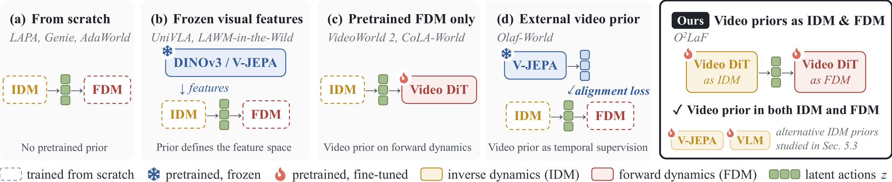

# O²LaF: One Prior, Two Dynamics

[](https://arxiv.org/abs/2611.26617)
[](https://showlab.github.io/o2laf/)
[](https://github.com/showlab/o2laf)
[](https://huggingface.co/YuxinJ/O2LaF)

<p align="center">
  
</p>

---

## TODO

- [x] Paper
- [x] Project page
- [ ] Code and model weights (coming in the next few days)

## Citation

```bibtex
@article{jiang2026o2laf,
  title   = {One Prior, Two Dynamics: Repurposing Video Diffusion Transformers for Self-Supervised Latent Action Learning},
  author  = {Jiang, Yuxin and Sun, Wenqiang and Li, Jiaqi and Gu, Yuchao and Zhang, Lvmin and Tsang, Ivor and Shou, Mike Zheng},
  journal = {arXiv preprint arXiv:2611.26617},
  year    = {2026}
}
```
